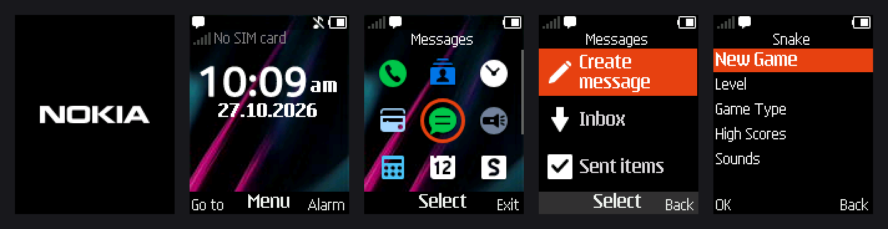
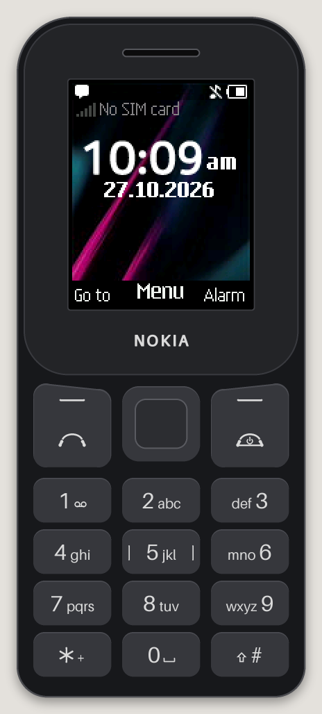

# nokia105-emu

An emulator for the **Nokia 105 (2022, TA-1423)**, a Series 30+ feature
phone built on the UNISOC **SC6531E** (ARM926EJ-S). It boots an unmodified
dump of the phone's flash from the boot ROM onward, through the ThreadX
kernel to the home screen, and the menus can be driven by clicking the keys
of the phone drawn around the screen, or from your keyboard.



The CPU is emulated with [Unicorn](https://www.unicorn-engine.org/); the
chip's peripherals are reimplemented in Python from what the firmware
expects of them: interrupt controller, timers, SPI flash, hardware LZMA,
LCD controller and panel, the JPEG decoder and colour converter, keypad,
the PMIC (RTC and alarm, ADC, charger, external interrupts, audio codec,
backlight LEDs), eFuse, GPIO, the DMA controller and voice-band codec that play sound, the
FM receiver (with a synthetic band to tune to), and enough of the DSP
mailbox to get past start-up.

**No firmware is included.** You need to dump your own phone; see
[docs/DUMPING.md](docs/DUMPING.md).

<p align="center"></p>

## Status

Works:
- Cold boot from the boot ROM: NOKIA logo, then the home screen in about
  7.5 s of emulated time.
- Home screen with the JPEG wallpaper, a clock that runs from your
  computer's local time, and status icons.
- Keypad input: main menu, Messages, Calendar, Snake and the other menus,
  Back and the red end key.
- Display sleep and wake, and headset plug/unplug.
- Battery and charger: plug the charger in (`p`) and the phone shows
  Charging and fills the battery icon, then "Battery full. Unplug charger
  from socket." when it is full (charging takes `--charge-minutes`, 10 by
  default, from empty). Unplugged early it says the battery isn't fully
  charged. Lower the battery with `-` to see Battery low, Low battery and
  finally Battery empty, when the phone switches itself off. Plugged into a
  phone that is off, the charger starts it in charging-only mode, as on the
  real phone. The battery level is kept with the saved phone.
- Switching off and on: hold the red key (Esc) to switch the phone off,
  and hold it again to switch it back on. It boots from its saved
  settings with the clock carried on; let go too soon and it switches off
  again, as the real phone does. A headless run ends when the phone
  switches off ("stop: powered off").
- Alarms: an alarm set in the Alarm app rings at its time with the alarm
  screen and tone, and Stop and Snooze work. Alarms are kept with the
  phone's settings, so they ring in later sessions too (while the
  emulator is running, like the real phone while it is on).
- Lights: the screen follows the phone's backlight, dimming with its
  Intensity setting and going dark when the backlight times out; the key
  labels light up with the keypad backlight; and the torch (Up twice on
  the home screen, or hold Up) glows on the top edge of the phone.
- Sound: ringtones, alerts, the start-up tune and keypad tones play through
  the speakers (via `ffplay`) and are saved to `out/audio.wav`. They follow
  the phone's own settings: a phone dumped in the Silent profile, as the
  TA-1423 used here was, stays quiet until you switch to General (Menu →
  Settings → Profiles → General → Activate), and keypad tones play only if
  their level (Settings → Tone settings → Keypad tones) is above zero.
- The phone keeps its settings (profile, ringtone, keypad and ringing
  volume, alarms, contacts, messages): the live window keeps the phone's
  flash in `state/flash.bin` and boots from it next time. It saves a couple
  of seconds after each change and again when the window closes, whether by
  the close button, Cmd+Q or Ctrl+C in the terminal, so even a crash loses
  at most the last change.
- A live window that runs at the phone's real speed, menus open
  instantly. It shows the screen in a drawing of the phone whose keys you
  can click.
- A fast start: the window runs the boot ahead of real time, skipping the
  phone's waits but playing the start-up tune at its own pace, and then
  sets the phone's clock back to the real time. The home screen appears
  about 2 s after launch (3 s with the start-up tune) instead of the
  phone's own 7.5 s; switching on and charging mode start as fast.
  `--slow-boot` shows the boot at the phone's pace.
- Headless runs several times faster than real time (boot to the home
  screen in under 2 s).
- FM radio, without sound: the receiver is modelled (`fm.py`) with a
  synthetic band of eight stations, so the Radio app opens on its saved
  station, steps through saved channels and manual tuning, and Auto tuning
  finds and saves the seven strong enough to stop a seek. Plug a headset
  in first (`--headset` or `h`): it is the antenna. `out/fm.log` records
  every tune, seek and interrupt.

Doesn't work (yet):
- No SIM, network or radio: the DSP is only a stub, so "No SIM card".
- Call audio and FM radio are silent: the FM receiver tunes but produces
  no audio, and the Radio app has no signal meter to show.
- No camera or USB. Started by the charger, the phone first waits 15 s
  for a PC on its USB port before it shows the charging screen.
- No vibration. The phone's own vibrator test only powers the audio path up
  and down, and no register that drives a motor was found.
- Only tested with firmware `MOCOR_20C_6531E_W23.19.4` from a TA-1423.
  Other SC6531E phones will need changes.

## Quick start

Requirements: Python 3 with Tk for the live window (Homebrew:
`brew install python-tk`), a C compiler, and `ffplay` from ffmpeg for sound
(`brew install ffmpeg`; without it sound only goes to `out/audio.wav`). Developed and tested on macOS
with Python 3.14; Linux should work, since the Makefile builds a `.so`
there, but hasn't been tested.

```sh
git clone https://github.com/rohit746/nokia105-emu
cd nokia105-emu
python3 -m venv .venv
.venv/bin/pip install -r requirements.txt
make                          # builds the two native helper libraries
mkdir dump                    # put flash.bin and bootrom.bin here
./run.sh                      # opens the live window
```

The home screen appears within a few seconds: the window runs the boot
ahead of real time (`--slow-boot` shows it at the phone's own pace, about
7.5 s).

<p align="center"></p>

### Controls

Click the keys on the phone in the window, or use the keyboard:

| Key | Phone |
|---|---|
| Arrow keys | navigation |
| Enter / Space | select (centre key) |
| `[` / F1 | left soft key |
| `]` / F2 / Backspace | right soft key (usually Back) |
| `c` | call (green) |
| Esc | end / power (red); hold to switch off, and on again |
| `0`-`9`, `*`, `#` | keypad |
| `h` | plug / unplug a headset |
| `s` | screenshot: the screen at 3x, and the whole phone, to `out/shots/` |
| `r` | start / stop recording the screen as an animated GIF, to `out/shots/` |
| `p` | plug / unplug the charger |
| `-` / `=` | battery 0.1 V lower / higher |

The Screenshot and Record buttons under the phone do the same.

## Command-line options

`run.sh` passes its options to `live.py`; `emu.py` runs headless with the
same options and saves every new screen to `out/frames/`.

| Option | |
|---|---|
| `--dump DIR` | directory with `flash.bin` and `bootrom.bin` (default `$NOKIA_DUMP`, `./dump` or `../dump`) |
| `--rtc-time 2026-10-27T10:09:00` | RTC time at power-on (default: now) |
| `--headset` | boot with a headset plugged in (the FM antenna; the TA-1557 sees it on PMIC EIC line 4) |
| `--sim`, `--sim-slot N` | insert a test 2G SIM card (`sim.py`) in slot N (0 = SIM1); every command it gets is logged to `out/sim.log`. Without `--sim` the phone has no SIM, as before |
| `--inject-sms MS:NUMBER:TEXT` | a live incoming text at emulated time MS (repeatable; needs `--sim`): written to the card's first free `EF_SMS` record (status 03, UCS-2), then `APP_MN_SMS_IND` 0xa1a7 with its record_id/storage and the decoded SMS is dispatched on the APP task through `DispatchSysSig`, so the stock SMS handlers run (`mt_sms.py`); every `--inject-sms`, `--inject-call` and `--inject-call-event` shares one ordered queue on the APP dispatch (`app_dispatch.py`), so any number may fall on the same ms; `out/inject-sms.log` has each step and the unread count before/after |
| `--inject-call MS:NUMBER[:ENDMS]` | a live incoming call at emulated time MS (repeatable): `APP_MN_SETUP_IND` 0xa15d (call_id 0, SIM1, normal voice, NUMBER as BCD; a leading `+` = international) is dispatched on the APP task through `DispatchSysSig`, so the stock CC handlers run; at ENDMS (optional) `APP_MN_DISCONNECTED_IND` 0xa15b (cause 16) is dispatched the same way, the far end hanging up (`mt_call.py`); MN's own call state is not modelled (MN never answers: script that with `--inject-call-event`); `out/inject-call.log` has each step |
| `--inject-call-event MS:KIND[:ARG]` | a CC event for call_id 0 (SIM1) at emulated time MS (repeatable), dispatched on the APP task through `DispatchSysSig` like `--inject-call`: `alerting[:TYPE]` = `APP_MN_ALERTING_IND` 0xa158, `connect` = `APP_MN_SETUP_COMPLETE_IND` 0xa159 (MT: the answer completed), `connect:mo` = `APP_MN_SETUP_COMPLETE_CNF` 0xa15a (MO: the far end answered), `disc:CAUSE` = `APP_MN_CALL_DISCONNECTED_IND` 0xa15b, `err:CAUSE` = `APP_MN_CALL_ERR_IND` 0xa15c (ids: the 2013 list +1, see `mt_call.py`); on the LughOS image, `connect` after a shell answer is followed within ~1 s by a restart into the boot ROM (pc 0x000176eb at 29087 ms, then a loop at 0x00012046; open: MN state not modelled) |
| `--log-calls` | log each call the firmware makes to `MNCALL_StartCallEx` 0x0823f04d / `MNCALL_ConnectCallEx` 0x0823f241 / `MNCALL_DisconnectCallEx` 0x0823f307 (name, args, caller lr, emulated ms) to `out/inject-call.log` as `call NAME(...)` lines; implied by `--inject-call` and `--inject-call-event` |
| `--mute` | don't play sound in the live window (still saved to `out/audio.wav`) |
| `--fresh` | live window: start again from the dump (the previous `state/flash.bin` is kept as `.old`) |
| `--state FILE` | keep the phone's flash in FILE (the live window uses `state/flash.bin`; headless runs start from the dump unless given this) |
| `--scale N` | window pixels per LCD pixel (`live.py`; default: the largest up to 3 that fits the screen, in steps of 0.25) |
| `--no-skin` | show only the screen, without the phone around it (`live.py`) |
| `--slow-boot` | boot at the phone's own pace instead of skipping its waits (`live.py`) |
| `--keys MS:KEY[:HOLD],…` | scripted key presses at emulated times, e.g. `10000:select,12000:down`; `charger` and `headset` plug in for HOLD ms, e.g. `12000:charger:60000` |
| `--max-blocks N` | stop after N translation blocks (4000 blocks = 1 ms) |
| `--battery-mv MV` | battery voltage at power-on (default: as the saved phone left it, else 3900) |
| `--charger`, `--charge-minutes N` | start with the charger plugged in; minutes to charge from empty to full (default 10) |
| `--no-battery`, `--adc CH=RAW` | other power-supply readings |
| `--break ADDR,…`, `--trace-after BLOCK`, `--trace-addrs LO:HI` | debugging: breakpoints, MMIO trace to `out/mmio_trace.log` |
| `--slow`, `--trace-blocks A:B`, `-v` | per-block Python hook: counts unique blocks, traces blocks (much slower) |

Example, headless: boot, open the menu and save the screens:

```sh
.venv/bin/python -I emu.py --keys 10000:select,12500:down --max-blocks 60000000
```

At the end of a run `out/report.txt` lists the final registers, interrupt
counts and every peripheral register touched; `out/psram.bin` and
`out/iram.bin` are RAM dumps.

## Testing

`make test` runs scripted sessions headless and checks them against a
reference recorded earlier from your dump: the boot and a menu tour; an
alarm set, rung and stopped, with the lights timing out; switching off;
charging to full; a flat battery switching the phone off; and the Radio
app with Auto tuning. It then drives the FM receiver's registers
directly, as a driver would (`tests/fm_protocol.py`). Emulation is deterministic, so every log line, screen
and sound sample has to match; a difference is reported with the first
log line, screen and moment of sound that changed, and the changed screen
is saved next to the reference one in `out/test/`. The runs take a few
seconds.

The reference is made from your firmware, so it isn't in the repository:
record it with `make test-update` on a version you trust (a release, say)
before changing anything, and again after a change that is meant to alter
what the phone does.

## How it works

- **Time** is counted in translation blocks: 4000 blocks are one emulated
  millisecond. A small native block hook (`blockclock.c`, registered
  through Unicorn's C API) counts them and only returns to Python when a
  timer or device event is due or an interrupt can be taken. It also keeps
  the system's millisecond and 32 kHz counters current in memory, so the
  firmware's delay loops run at native speed. When the firmware executes
  wait-for-interrupt, the emulator skips ahead to the next event; in the
  live window it is paced to the wall clock instead, except during the
  boot while nothing audible plays, after which the RTC is set back by
  the time skipped.
- **Interrupts** come from the device models through the interrupt
  controller; `arm_exc.py` delivers IRQs and aborts itself, walking the
  guest's page tables for faulting addresses.
- **Demand paging**: the MMI code is paged in from flash on aborts, with
  the hardware LZMA engine decompressing through `lzma_sprd.c` (Spreadtrum's
  LZMA variant).
- **Display**: the MMI draws into a framebuffer; the LCD controller model
  composes its layers and streams them to the panel model over SPI1.
- **JPEG**: the firmware programs the decoder's tables and scan data; the
  model rebuilds a standard JPEG from them and decodes it with Pillow, then
  does the hardware's colour conversion and scaling.

[docs/HARDWARE.md](docs/HARDWARE.md) has the register-level notes: memory
map, every modelled peripheral, and the firmware addresses behind them.

## Layout

| File | |
|---|---|
| `emu.py` | machine: memory map, register file, scheduler, CLI |
| `blockclock.c` | native block hook: the emulated clock |
| `live.py`, `run.sh` | live window |
| `skin.py` | the phone drawn around the screen, and where its keys are |
| `arm_exc.py` | exception entry and page-table walks |
| `irq.py` | interrupt controller and timers |
| `sfc.py`, `lzma_engine.py`, `lzma_sprd.c` | SPI flash, LZMA engine |
| `lcd.py` | LCD controller, SPI1, panel |
| `jpeg_hw.py` | JPEG decoder and colour converter |
| `keypad.py`, `eic.py`, `pmic.py` | keypad, digital EIC, PMIC (RTC, EIC) |
| `audio.py` | DMA controller and voice-band codec: sound output |
| `lights.py` | screen and keypad backlights, torch |
| `battery.py` | battery, charger, and the eFuse calibration the ADC needs |
| `dsp.py` | DSP mailbox stub |
| `fm.py` | FM receiver, its RF registers, and the synthetic band |
| `disasm.py`, `mkelf.py` | helpers: disassemble a range; wrap a raw image as an ELF for Ghidra |
| `tests/regress.py` | `make test`: scripted runs checked against a recorded reference |
| `mt_call_selftest.py` | `--inject-call` / `--inject-call-event` / `--inject-sms` overlap / MNCALL call log on the LughOS phone image (`--emu DIR --dump DIR --out DIR`); evidence in `evidence/mt_call_selftest-*.txt` |
| `tests/fm_protocol.py` | `make test`: the FM receiver's registers, driven as a driver would |
| `third_party/lzmadec.h` | LZMA decoder from spreadtrum_flash (public domain) |

## Credits

- [spreadtrum_flash](https://github.com/ilyakurdyukov/spreadtrum_flash) and
  [fpdoom](https://github.com/ilyakurdyukov/fpdoom) by Ilya Kurdyukov: the
  dumping tools, the LZMA decoder, and register layouts for SC6531E
  peripherals that made this possible.
- [Unicorn](https://www.unicorn-engine.org/),
  [Capstone](https://www.capstone-engine.org/) and
  [Pillow](https://python-pillow.org/).

## Legal

This project contains no firmware or code from Nokia, HMD Global or UNISOC.
It was written by observing how the phone's firmware uses its hardware.
Nokia is a trademark of Nokia Corporation; this project is not affiliated
with or endorsed by Nokia, HMD Global or UNISOC. Screenshots show the
phone's own interface, running in the emulator; the phone around the
screen in the live window is drawn by `skin.py`. Only use firmware you
dumped from a phone you own.

## License

MIT, see [LICENSE](LICENSE). `third_party/lzmadec.h` is public domain.
